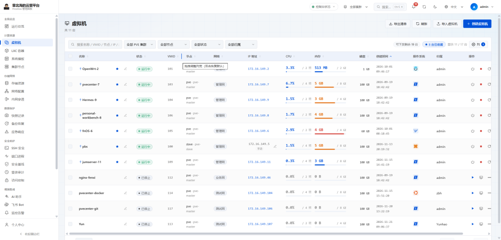
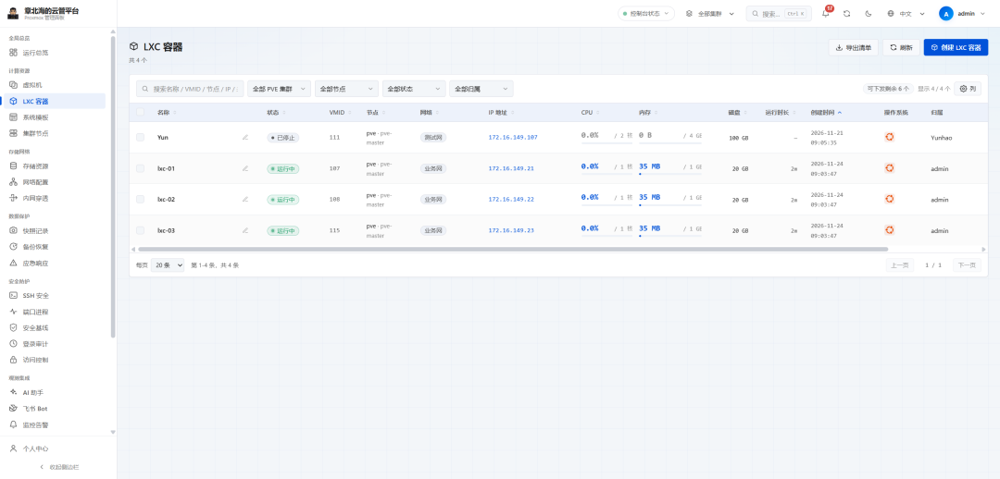
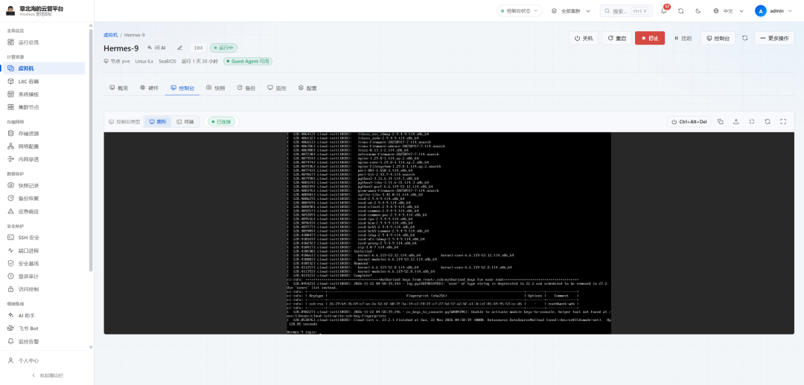

<div align="center">
<p></p>
<p>
  <a href="LICENSE"></a>
  <a href="../../releases"></a>
  <a href="https://github.com/yjscloud/pvecenter/actions/workflows/ci.yml"></a>
  <a href="../../stargazers"></a>
  <a href="../../forks"></a>
  <a href="../../issues"></a>
</p>
<p>
  
  
  
  
  
</p>
<p>
  <a href="#quick-start"><b>Quick start</b></a> ·
  <a href="#documentation">Docs</a> ·
  <a href="README.md">简体中文</a>
</p>
</div>

**pvecenter** is an open-source, self-hosted **Proxmox VE (PVE) web management panel**. One interface for QEMU virtual machines, LXC containers, cloud-init templates, storage and networking, snapshots and backups, internal tunneling, the VNC console, certificates and account permissions — and it can drive several PVE hosts at once. Install it as a systemd service or run it with Docker; it comes back by itself after a reboot.

In short: PVE does the virtualization; pvecenter is the operations layer on top — several clusters in one view, batch rollouts, and the accounts, quotas, certificates and audit that PVE does not provide.

Built for homelabs, small teams, and anyone who needs to open a PVE cluster to several people.

**Live demo:** <https://pvecenter.yjscloud.com>. No shared account: register on the login page, and sign in once an admin approves; ping me on WeChat if you need one now.

> 自托管的 **Proxmox VE（PVE）Web 管理面板**：QEMU 虚拟机、LXC 容器、cloud-init 模板、网络与防火墙、备份、监控、证书与 RBAC。
>
> Keywords: Proxmox VE panel · PVE panel · PVE web UI · LXC container management · QEMU / KVM · cloud-init templates · self-hosted virtualization platform · Proxmox alternative UI · homelab · self-hosted

---

## Contents

- [Contact and feedback](#contact-and-feedback) · [Screenshots](#screenshots) · [Key features](#key-features)
- [Quick start](#quick-start) · [Requirements](#requirements) · [Bare metal](#bare-metal) · [Docker](#docker) · [Connect a PVE host](#connect-a-pve-host)
- [Documentation](#documentation) · [License](#license)

---

## Contact and feedback

Questions, feature requests or help with deployment: scan the WeChat code below, or leave a note in [Issues](https://github.com/yjscloud/pvecenter/issues). Some features have not been tested hard yet — just say what broke.

pvecenter is maintained by one person. If it saved you time, a voluntary tip helps pay for servers, test environments and the upkeep; not tipping changes nothing about the software or the support you get.

<table>
  <tr>
    <td align="center" width="33%"><a href="docs/screenshots/wechat.png"></a><br><sub><b>WeChat</b> · feedback / deployment help</sub></td>
    <td align="center" width="33%"><a href="docs/screenshots/weixin.jpg"></a><br><sub><b>Tip</b> · voluntary</sub></td>
    <td align="center" width="33%"><a href="docs/screenshots/zhifubao.jpg"></a><br><sub><b>Alipay tip</b> · voluntary</sub></td>
  </tr>
</table>

> Do not open a public issue for a security problem. Use the private channel in [SECURITY.md](.github/SECURITY.md).

---

## Screenshots

<table>
  <tr>
    <td width="50%"><a href="docs/screenshots/dashboard.png"></a><br><sub><b>Dashboard</b> · cluster status / resource use / distribution</sub></td>
    <td width="50%"><a href="docs/screenshots/vm-list.png"></a><br><sub><b>VM list</b> · batch actions / migration / quotas</sub></td>
  </tr>
  <tr>
    <td width="50%"><a href="docs/screenshots/lxc-list.png"></a><br><sub><b>LXC containers</b> · lifecycle / snapshots / migration</sub></td>
    <td width="50%"><a href="docs/screenshots/console.png"></a><br><sub><b>Console</b> · graphical / terminal, from the browser</sub></td>
  </tr>
</table>

---

## Key features

| Area | What it does |
|---|---|
| **VMs and containers** | four-step and batch creation, power operations, cloning, migration, live reconfiguration, disk resize, snapshots, OS reinstall; OVF / OVA import and VMDK / QCOW2 / RAW / OVA export |
| **Templates and storage** | a cloud-init template pipeline; browse and upload storage content (suffix corrected by file magic), or let PVE download it from a URL |
| **Networking** | bridge / bond / VLAN, the native PVE firewall and security groups, IP address pools, a built-in frpc tunnel |
| **Monitoring and backup** | live metrics, RRD charts, capacity forecasting, disk SMART / ZFS; backup now or on a schedule, delete protection, optional read-only PBS access |
| **Security operations** | SSH brute-force protection, login and action audit, security baseline, port and process inspection, emergency response |
| **Certificates and accounts** | multi-cloud / ACME certificates with auto-renewal and deployment; built-in and custom roles, quotas, two-factor auth, API tokens |
| **AI assistant** | attributes findings from inspection data, read-only command allowlist, write commands approved one by one |
| **Day to day** | background jobs, task queue, in-app notifications, a `Ctrl / ⌘ + K` command palette, one-click updates, branding and nav switches |

A few areas are read-only: quorum, HA, Ceph and SDN status are visible here but configured in PVE, PBS prune / GC / verify stay in the PBS console, and installing or upgrading the PVE nodes themselves is out of scope.

Each module's scope, parameters and known limits are documented area by area in the [feature guide](docs/features.en.md).

---

## Quick start

Two ways in, pick one: bare metal with `deploy.sh`, or Docker only.

### Requirements

| Component | Version | Notes |
|---|---|---|
| Proxmox VE | 8.x / 9.x | tested on 8.4 and 9; both run the same code |
| Python | 3.11+ | 3.9 / 3.10 are rejected at startup |
| Database | MySQL 8.0+ or MariaDB | standard MySQL protocol; the bare-metal script installs MariaDB (10.11 on Debian 12) and the Docker image defaults to `mysql:8.0`; tables are created on first start |
| Node.js | 22.22+ | automatic: `deploy.sh` installs it; only needed up front if you build the frontend by hand |
| Docker + Compose | v2 | only for the container route |

The panel itself is light; a 2-core, 2 GB machine is enough:

| Resource | Starting point | Notes |
|---|---|---|
| CPU | 2 cores | 1 core works, but frontend builds and batch operations get noticeably slower |
| RAM | 2 GB | the frontend build (`npm run build`) is the peak; 1 GB machines often stall there. The Docker image does not build |
| Disk | 3 GB | source, dependencies, virtualenv and built assets come to about 1 GB; the rest is logs, metrics history and the database |

**Where to run it**: keep it out of the PVE host's root filesystem. The usual setup is one small VM on PVE: `deploy.sh` installs MariaDB and a systemd service inside that VM, and the baseline checks and SSH audit read its logs. Put it on the host instead and those readings become the PVE node's own, so you can no longer tell which layer a problem came from.

**OS**: Linux with systemd. Debian 12+, Ubuntu 24.04+, the RHEL 9 family (Rocky 9 / Alma 9 / TencentOS 4 / openEuler) and Fedora install straight away: their repos carry Python 3.11 and `deploy.sh` pulls in whatever else is missing. RHEL 8 / CentOS 8, Ubuntu 20.04 / 22.04 and Debian 11 run too, once Python 3.11 is in place; the script tries once and prints the commands if it cannot work it out.

### Bare metal

```bash
git clone https://github.com/yjscloud/pvecenter.git
cd pvecenter
sudo ./deploy.sh
```

One run installs the Python dependencies, builds the frontend, creates the database and registers a systemd service. No prompts along the way. The last screen prints the panel address and the initial password, shown only once. Running it again does not break an existing install.

To set the port or the database name:

```bash
sudo ./deploy.sh --port 9000 --db-name pvecenter_panel
```

`./deploy.sh --help` lists everything. Ports, HTTPS, the reverse proxy and service management are in the [deployment guide](docs/deployment.md) (Chinese).

Check that it came up:

```bash
curl http://127.0.0.1:8080/api/health
```

### Docker

No Python / Node / database on the server? Docker is enough:

```bash
curl -fsSLO https://raw.githubusercontent.com/yjscloud/pvecenter/main/docker-compose.yml
export ADMIN_PASSWORD="$(openssl rand -base64 18)"
echo "login password: $ADMIN_PASSWORD"
docker compose up -d
```

Open `http://your-server-ip:8080`, account `admin`, password the one just generated and printed (the backend refuses to start with fewer than 12 characters).

That password is only used to create the admin while the database has none; re-running the command on an existing install does not change it, so use Profile → Change password in that case. The database and DB-admin passwords live in `docker-compose.yml` under `★ 改这里`; change those too before exposing the port.

### Connect a PVE host

First thing after logging in: connect a PVE host. If you would rather not create a user, issue a token and fill in the form by hand, use batch connect.

**Open the panel → Cluster nodes → Connection settings → Batch connect**, and the panel generates a command. Paste it into the PVE node as root. The script creates the account, issues the token, registers the connection and checks the result, rolling back and saying what went wrong if it fails.

The link can be limited to a number of uses: 1 by default, or 5, 10, unlimited, which is what you want when connecting several hosts at once. Re-running it on the same cluster does not use up a use; an exhausted or expired link stops working.

<p align="center">
  <a href="https://www.bilibili.com/video/BV1fqySzKEzv/">
    
  </a>
  <br>
  <sub>▶ Click the cover to watch the demo (4 min, Chinese): batch connect PVE nodes, batch operations and migration for VMs and containers</sub>
</p>

---

## Documentation

Pick by what you are trying to do; no need to read it front to back. Most detailed docs are written in Chinese, and the feature guide has an English heading-level outline.

| I want to… | Read |
|---|---|
| Install it, change the port, use Docker | [Deployment](docs/deployment.md) |
| Put the panel on the public internet | [Hardening](docs/hardening.md) |
| Look up an `.env` variable | [Configuration](docs/configuration.md) |
| Understand what a feature does | [Features (English outline)](docs/features.en.md) |
| Fix an empty list, a PVE connection error, a black console | [Troubleshooting](docs/troubleshooting.md) |
| Work on the code, run the tests | [Layout and tests](docs/development.md) |
| Send a pull request | [Contributing](CONTRIBUTING.md) |
| See what is planned | [Roadmap](docs/roadmap.md) |
| PBS, frp real IP, alert mail, data ownership | [All docs](docs/README.md) |

Full index: [docs/README.md](docs/README.md).

---

## License

[Apache-2.0](LICENSE). Read the [contributing guide](CONTRIBUTING.md) before sending a pull request.

If this project helps you, a star is the most direct way to support it.
