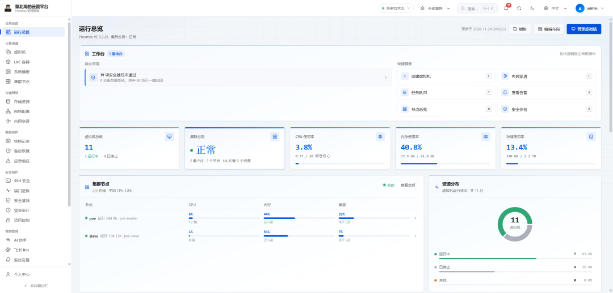
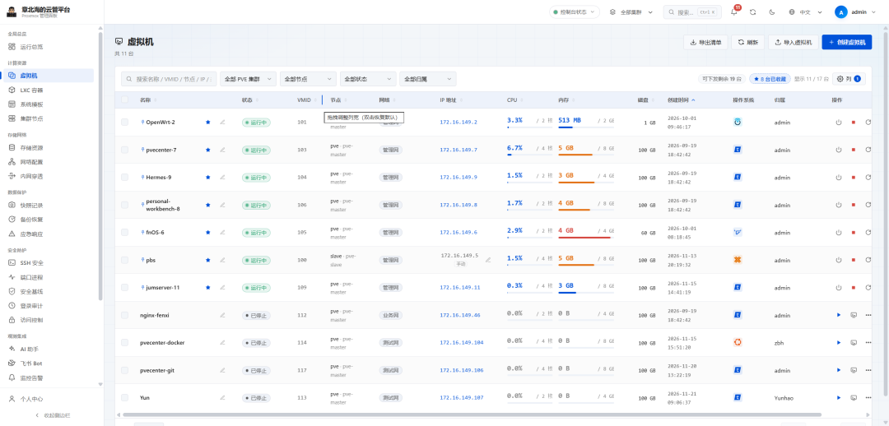
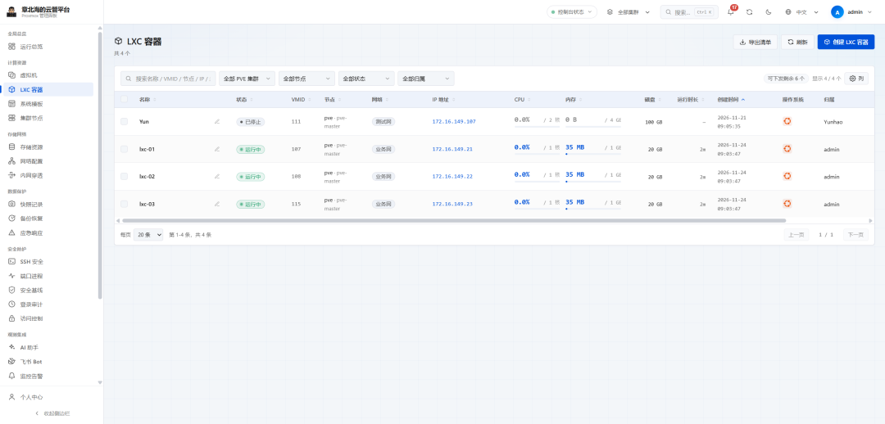
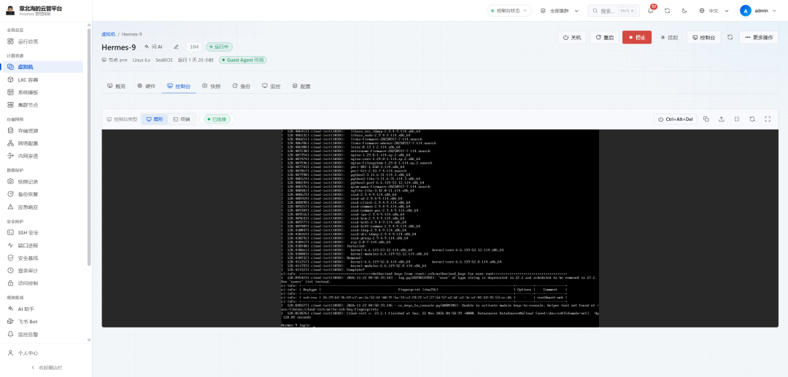
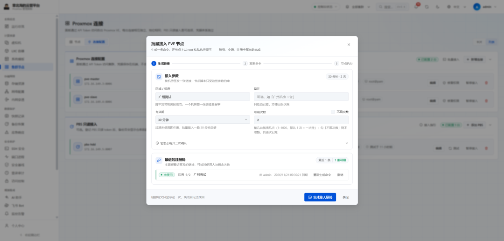

<div align="center">
<h1>pvecenter</h1>
<p><b>Proxmox VE 8.x / 9.x 管理面板</b><br>
<sub>虚拟机 · 容器 · 模板 · 网络 · 备份 · 证书 · 权限，一个界面管完</sub></p>
<p>
  <a href="LICENSE"></a>
  <a href="../../releases"></a>
  <a href="https://github.com/yjscloud/pvecenter/actions/workflows/ci.yml"></a>
  <a href="../../stargazers"></a>
  <a href="../../forks"></a>
  <a href="../../issues"></a>
</p>
<p>
  
  
  
  
  
</p>
<p>
  <a href="#快速开始"><b>快速开始</b></a> ·
  <a href="#文档">文档</a> ·
  <a href="README.en.md">English</a>
</p>
</div>

**pvecenter** 是一个开源自托管的 **Proxmox VE（PVE）Web 管理面板**。一套界面管 QEMU 虚拟机、LXC 容器、cloud-init 模板、存储与网络、快照备份、内网穿透、VNC 控制台、证书和账号权限，还能同时接管多台 PVE。装成 systemd 服务或用 Docker 跑，机器重启后自己起来。

一句话概括：PVE 负责虚拟化，pvecenter 负责它上面那层运营：多台集群收进一个视图、批量下发，再加上账号、配额、证书和审计。每项的细节和边界在 [功能说明](docs/features.md)。

> Self-hosted **Proxmox VE (PVE) web UI** for QEMU VMs, LXC containers, cloud-init templates,
> networking, firewalls, backups, monitoring, certificates and RBAC.
>
> 适合家庭实验室（homelab）、小团队，以及要把 PVE 开放给多人用的场景。

> 关键词：Proxmox VE 管理面板 · PVE 面板 · PVE Web UI · LXC 容器管理 · QEMU / KVM ·
> cloud-init 模板 · 自托管虚拟化平台 · Proxmox alternative UI · homelab · self-hosted

**在线演示**：<https://pvecenter.yjscloud.com>

## 目录

- [联系与支持](#联系与支持) · [界面预览](#界面预览) · [核心功能](#核心功能)
- [快速开始](#快速开始) · [环境要求](#环境要求) · [裸机安装](#裸机安装) · [Docker 安装](#docker-安装) · [接入 PVE](#接入-pve)
- [文档](#文档) · [许可证](#许可证)

---

## 联系与支持

遇到问题、想提建议，或者需要部署协助，扫码加微信；也可以到
[Issues](https://github.com/yjscloud/pvecenter/issues) 留言。部分功能还没经过充分测试，遇到问题直接说。

pvecenter 由个人维护。它帮你省下时间的话，欢迎自愿赞赏，用于服务器、测试环境和后续维护；不赞赏也完全不影响使用和技术支持。

<table>
  <tr>
    <td align="center" width="33%"><a href="docs/screenshots/wechat.png"></a><br><sub><b>微信联系</b> · 问题反馈 / 部署协助</sub></td>
    <td align="center" width="33%"><a href="docs/screenshots/weixin.jpg"></a><br><sub><b>微信赞赏</b> · 自愿支持</sub></td>
    <td align="center" width="33%"><a href="docs/screenshots/zhifubao.jpg"></a><br><sub><b>支付宝赞赏</b> · 自愿支持</sub></td>
  </tr>
</table>

> 安全漏洞不要开公开 issue，走 [SECURITY.md](.github/SECURITY.md) 里的私下渠道。

---

## 界面预览

<table>
  <tr>
    <td width="50%"><a href="docs/screenshots/dashboard.png"></a><br><sub><b>运行总览</b> · 集群状态 / 资源占用 / 资源分布</sub></td>
    <td width="50%"><a href="docs/screenshots/vm-list.png"></a><br><sub><b>虚拟机列表</b> · 批量操作 / 迁移 / 配额</sub></td>
  </tr>
  <tr>
    <td width="50%"><a href="docs/screenshots/lxc-list.png"></a><br><sub><b>LXC 容器</b> · 生命周期 / 快照 / 迁移</sub></td>
    <td width="50%"><a href="docs/screenshots/console.png"></a><br><sub><b>控制台</b> · 图形 / 终端，浏览器内直接操作</sub></td>
  </tr>
</table>

---

## 核心功能

| 模块 | 能做什么 |
|---|---|
| **虚拟机 / 容器** | 四步与批量创建、开关机、克隆、迁移、在线改配、扩容、快照、重装；OVF / OVA 导入，VMDK / QCOW2 / RAW / OVA 导出 |
| **模板与存储** | cloud-init 模板流水线；存储内容浏览、上传（按文件头校正后缀）、让 PVE 自己从链接下载 |
| **网络** | Bridge / Bond / VLAN、PVE 原生防火墙与安全组、IP 地址池、内置 frpc 内网穿透 |
| **监控与备份** | 实时指标、RRD 曲线、容量预测、磁盘 SMART / ZFS；立即与定时备份、防删保护、可选只读接入 PBS |
| **安全运维** | SSH 防爆破、登录与操作审计、安全基线、端口进程巡检、应急响应 |
| **证书与账号** | 多云 / ACME 证书自动续期并下发；内置与自定义角色、额度、两步验证、API 令牌 |
| **AI 助手** | 拿巡检数据做归因，只读命令白名单，写操作逐条审批 |
| **日常** | 后台作业、任务队列、站内通知、`Ctrl / ⌘ + K` 命令面板、一键更新、站点品牌与入口开关 |

上面每个模块的具体范围、参数和已知边界，[功能说明](docs/features.md) 里逐条写了。

---

## 快速开始

### 环境要求

| 组件 | 版本 | 说明 |
|---|---|---|
| Proxmox VE | 8.x / 9.x | 8.4 与 9 实测通过，两版走同一套代码 |
| Python | 3.11+ | 3.9 / 3.10 启动时会被拒绝 |
| 数据库 | MySQL 8.0+ 或 MariaDB | 走标准 MySQL 协议；裸机脚本默认装 MariaDB（Debian 12 是 10.11），Docker 镜像默认 `mysql:8.0`，建库后表结构自动创建 |
| Node.js | 22.22+ | 自动：`deploy.sh` 自己装，只有手工构建前端时才需要预装 |
| Docker + Compose | v2 | 只用容器方式时需要 |

面板本身很轻，但建议单独开一台虚拟机来跑，别和 PVE 挤在同一台：`deploy.sh` 会在这台机器上装 MariaDB、加 systemd 服务，安全基线和 SSH 登录审计读的也是这台机器的日志，混在 PVE 节点上，这些读数说的就是 PVE 自己。系统支持 Ubuntu、Debian、CentOS、TencentOS，RHEL / Rocky / Alma / openEuler 与 Alpine 也能装；Debian 12+ 和 Ubuntu 24.04+ 自带 Python 3.11，更老的版本得先补一个 3.11 再跑脚本。

| 资源 | 起步 | 说明 |
|---|---|---|
| CPU | 2 核 | 1 核也能跑，前端构建和批量下发会明显变慢 |
| 内存 | 2 GB | 前端构建（`npm run build`）是内存峰值，1 GB 的机器常卡在这一步；用 Docker 镜像不构建 |
| 磁盘 | 3 GB | 源码、依赖、虚拟环境与前端产物合计约 1 GB，其余留给日志、指标历史和数据库 |

### 裸机安装

```bash
git clone https://github.com/yjscloud/pvecenter.git
cd pvecenter
sudo ./deploy.sh
```

一次装完依赖、前端产物、数据库和 systemd 服务，全程不提问。最后一屏打印面板地址和初始口令，口令只显示这一次。重复执行不会弄坏已有配置，想指定端口或库名就直接传参：

```bash
sudo ./deploy.sh --port 9000 --db-name pvecenter_panel
```

完整参数用 `./deploy.sh --help` 看，端口、HTTPS、反代和服务管理的细节在 [部署指南](docs/deployment.md)。

装完确认服务起来了：

```bash
curl http://127.0.0.1:8080/api/health
```

### Docker 安装

不想在宿主机装 Python / Node / 数据库就用容器，宿主机只要有 Docker：

```bash
curl -fsSLO https://raw.githubusercontent.com/yjscloud/pvecenter/main/docker-compose.yml
export ADMIN_PASSWORD="$(openssl rand -base64 18)"
echo "登录口令：$ADMIN_PASSWORD"
docker compose up -d
```

打开 `http://你的服务器IP:8080`，账号 `admin`，口令就是上面生成并打印出来的那个（短于 12 位后端会拒绝启动）。连库口令和数据库管理员口令在 `docker-compose.yml` 里，搜 `★ 改这里`，公网部署前一并换掉。

### 接入 PVE

登录进去第一件事是把 PVE 接进来。不想手动建账号、发 Token、填表单，就走批量接入：

**打开面板 → 集群节点 → 连接配置 → 批量接入**，面板会生成一条命令。复制到 PVE 节点上以 root 执行，建账号、建令牌、注册到面板、结果自检都由脚本完成，失败自动回滚并说明原因。

链接可以设可用次数，默认 1 次（一次性），也可以填 5 次、10 次或不限，适合一次接多台；同一集群重复执行不消耗次数，次数用尽或过了有效期链接自动失效。

<p align="center">
  <a href="https://www.bilibili.com/video/BV1fqySzKEzv/">
    
  </a>
  <br>
  <sub>▶ 点击封面看视频演示（4 分钟）：批量接入 PVE 节点、虚拟机与容器的批量下发和迁移</sub>
</p>

---

## 文档

| 我想…… | 看这里 |
|---|---|
| 第一次装，或者换端口 / 上 HTTPS / 用 Docker | [部署](docs/deployment.md) |
| 面板要暴露到公网 | [公网暴露前后的加固](docs/hardening.md) |
| 查某个 `.env` 变量 | [配置项](docs/configuration.md) |
| 某个功能怎么用、边界在哪 | [功能说明](docs/features.md) |
| 列表全空 / 连不上 PVE / 控制台黑屏 | [排查问题](docs/troubleshooting.md) |
| 接手代码、跑测试 | [目录结构与测试](docs/development.md) |
| 想提 PR、问代码约定 | [贡献指南](CONTRIBUTING.md) |
| 后面打算做什么 | [路线图](docs/roadmap.md) |
| PBS、frp 真实 IP、告警邮件、数据归属 | [专题文档](docs/README.md) |

完整索引在 [docs/README.md](docs/README.md)。

---

## 许可证

本项目以 [Apache-2.0](LICENSE) 许可发布。

如果这个项目对你有帮助，点一个 Star 是最直接的支持。
