# 功能说明

按页面讲每个功能能做什么、边界在哪。只想看有哪些功能，[README](../README.md#核心功能) 里有张简表。

> 返回 [README](../README.md) · 相关：[部署](deployment.md) · [配置项](configuration.md)

## 虚拟机管理（QEMU / KVM）

四步创建向导（VMID、系统、磁盘与网卡、cloud-init），支持空白新建、从模板克隆、从 cloud 镜像导入。开关机（优雅关机会超时，兜底强制停止）、重启、挂起、恢复、删除；在线改 CPU / 内存 / 名称 / 标签 / 开机自启 / 保护模式，磁盘扩容、迁存储、跨节点迁移。列表能勾选多台批量执行，逐台回报，第 3 台失败不影响其余，也能只重试失败的。重置客户机用户口令优先走 Guest Agent（即时生效），没装 agent 或机器已关机就写 `cipassword` 走 cloud-init，并重新生成 config drive。

批量创建走同一个接口（`POST /api/vms/batch`），一次提交多台、逐台推进到成功或失败，失败项不自动重试。除了从模板 / 镜像创建，还能从 **OVF / OVA 导入**（上传 → 解析 OVF → 核对存储、网桥与总线，固件、控制器、EFI、串口这类不兼容项逐条提示）；**导出**走后台作业，支持 VMDK / QCOW2 / RAW / OVA，只允许导已关机的机器，产物直接流式下载；**重装系统**用 cloud-init 模板重建系统盘，保留 VMID、MAC、CPU 与磁盘拓扑，网络默认沿用原地址。

<!-- 截图占位：screenshots/vm-create.png -->
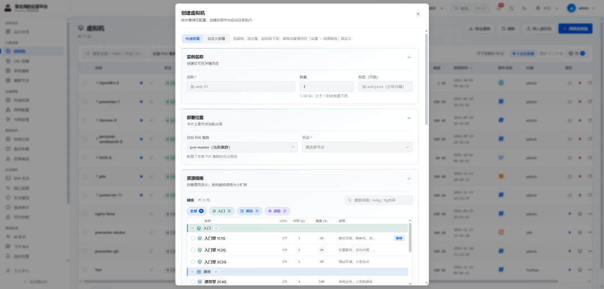

## LXC 容器管理

容器在 PVE 里是另一套 API 端点，面板里也是平行的一套页面。三步创建向导，模板来自节点上内容类型含 `vztmpl` 的存储（一个都没有时会给出 `pveam download` 命令）。生命周期、快照（不含内存状态）、克隆（只有全量，PVE 不支持容器链接克隆）、迁移、控制台；rootfs 和挂载点扩容、新增挂载点、迁存储；网卡增删，IP 直接写在网卡配置里，改完要重启。

<!-- 截图占位：screenshots/lxc-list.png -->
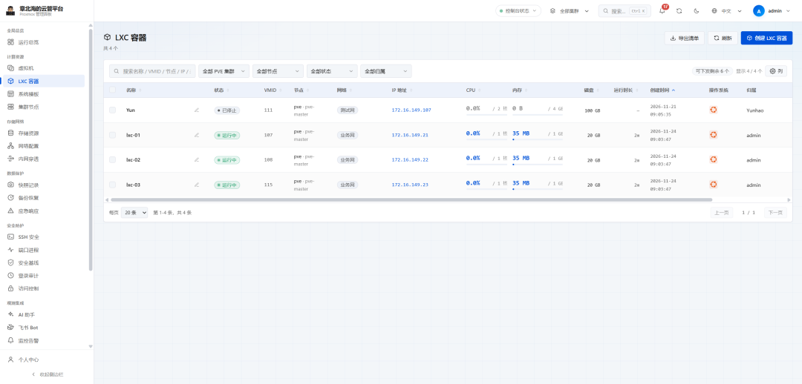

重置容器 root 口令走「SSH → 受管主机」。容器没有 Guest Agent，PVE 也没有「在容器里执行命令」的接口，只能借该宿主机的 SSH 凭据跑 `pct exec`。宿主没配凭据时弹窗会说明，并建议你进容器控制台自己 `passwd`。

## cloud-init 模板流水线

从 cloud 镜像一键建模板，后端按序执行、每步之间等任务完成：建虚拟机（系统盘用 `import-from=<镜像>` 让 PVE 直接导入，不再走 PVE 9.2 已移除的 `importdisk`）→ 配置启动顺序与 cloud-init 驱动 → 按需扩容 → 转模板。任何一步失败都会删掉临时虚拟机，不留半成品。建好之后用「从模板部署」批量开机，克隆时自动注入主机名、SSH 公钥和 IP。

<!-- 截图占位：screenshots/template-pipeline.png -->
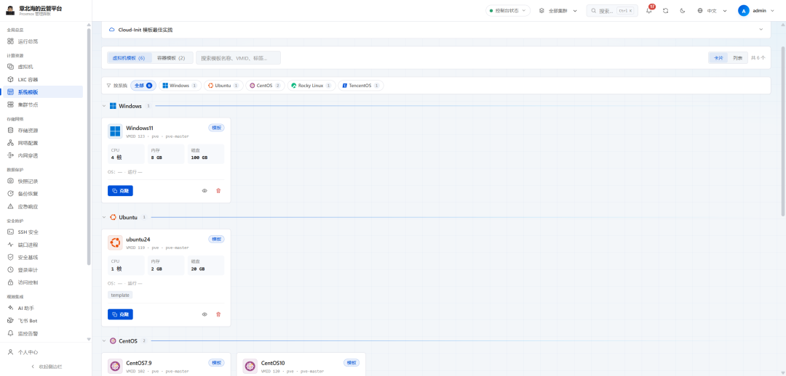

> **镜像的扩展名得和真实格式对得上**：`.qcow2` / `.raw` / `.vmdk` / `.vdi` / `.vpc` / `.qed`。PVE 只对这几种后缀解析容器，其余一律当裸盘整块复制。典型是 Ubuntu 官方的 `*-cloudimg-amd64.img`：它其实是 qcow2（3.5 GiB 虚拟、248 MiB 实际），被当裸盘复制后，系统盘第一扇区是 `QFI\xfb` 而不是引导签名，模板建得出来、开机却停在 `Boot failed: not a bootable disk`。面板上传时会按文件头识别并改对后缀（会提示）；从 PVE 网页或命令行直接传进来的文件拦不到，请自己改名，或先 `qemu-img convert -O raw 源文件 目标.raw`。
>
> 镜像放 dir / NFS / CIFS 或块存储都行：来源只需该节点读得到，目标存储支持 `images`。
>
> 也可以不手动下载：向导里填「镜像下载链接」，面板把链接交给 **PVE 自己**下载到所选存储的 import 目录（面板不中转字节，几十 GB 的镜像也不会占内存或撑爆反向代理），下完自动选为镜像来源。文件名会校正成 PVE 认的后缀（`.img` → `.qcow2`）。

## 节点与多 PVE 连接

一套面板可以同时接多台 Proxmox：节点、虚拟机、容器、存储、任务和全局搜索都**跨连接聚合**，每行标明来自哪条连接。两条连接上的同名节点、同名存储不会被并成一条 —— 它们是两台机器上各自独立的资源。

连接可以打「区域」标签（机房 / 环境），节点列表按「区域 → 连接 → 节点」展开。顶栏的集群作用域让当前页面只看一套集群（按用户保存，链接带 `?scope=`，只有一套连接时自动隐藏）。连接配置是管理员专属页面，Token 明文不回传前端。

加连接有两条路：在「连接配置」里手填地址和 Token，或者用**批量接入**生成一条命令，复制到 PVE 节点上以 root 执行。建账号、发令牌、注册连接、结果自检都由脚本完成，链接可以设有效期和可用次数。

<!-- 截图占位：screenshots/pve-batch-connect.png -->
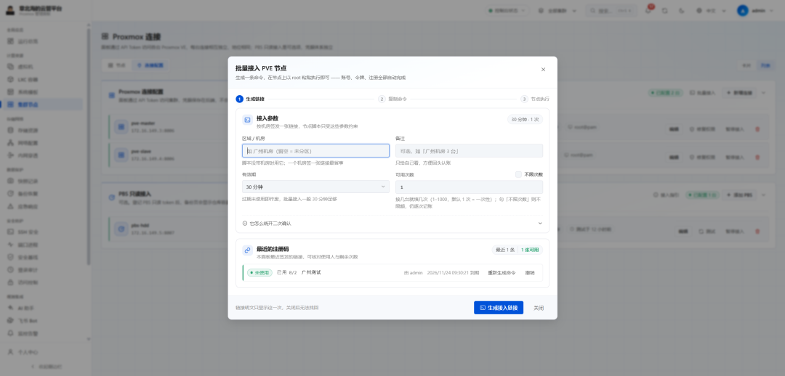

权限也按连接走：内置的 `region_admin` 只能看、只能管指派区域内的资源，没标区域的连接不归任何区域管理员（否则「忘了填区域」就成了谁都能管的缺口）。普通账号还能配节点可见范围：把特殊节点设成「对普通用户隐藏」，再按人 / 按角色放行。判定顺序是用户 > 角色 > 默认 > 无记录即可见，写操作在后端强校验。

节点详情里有磁盘健康卡片：SMART 属性与磨损度、故障属性高亮、ZFS 池状态与碎片。

把机器指派给别人（或收回）时，哪些数据跟着走、哪些不跟，以
[归属与安全数据边界](归属与安全数据边界.md) 为准。

## 存储管理

存储页按节点列出容量与使用率，能浏览 `images` / `iso` / `import` / `vztmpl` / `backup` / `snippets` 内容，上传、删除，或者不落本地，直接填链接让 PVE 去下载。

<!-- 截图占位：screenshots/storage.png -->
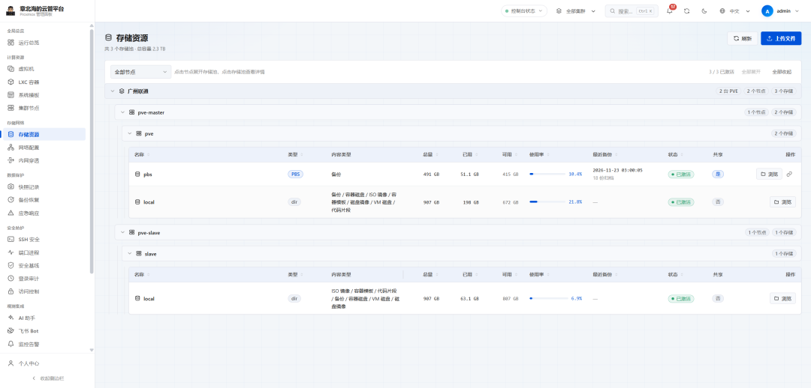

上传直传 PVE，不占面板内存。传之前读文件头判断容器格式：`iso` 目录里放 qcow2 / vmdk 会被当场拒绝并给出两种改法；`import` 目录会自动把后缀改对（`.img` → `.qcow2`）并告诉你改成了什么 —— 不然后果就是 PVE 按裸盘整块复制，模板开机停在 `not a bootable disk`。下载链接同理（压缩包、后缀不符在开始下载前就拒绝），下载任务只在结束时给结果，所以页面显示已用时间，不编造百分比。

普通用户看到的机器卷按归属裁剪；ISO、容器模板这类共享内容不受影响。

## 网络与防火墙（Bridge / Bond / VLAN）

节点级 Linux Bridge / Bond / VLAN 的增删改，改动先进「待应用」，点「应用配置」才生效，和 Proxmox 本身一致。这样改错网桥不会当场把节点网络断掉。

网络页是跨节点的只读汇总，接口、网桥、物理网卡和未激活的放在一起看，改配置要点进对应节点的「网络」标签页。IP 地址池也在这一页下半部分。

<!-- 截图占位：screenshots/network.png -->
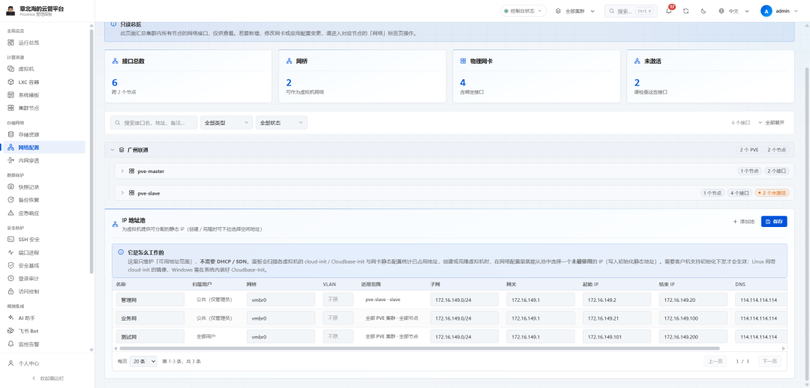

防火墙封装的是 Proxmox 原生防火墙，不是另起一套规则引擎，所以面板里配的规则和 PVE 界面、`pve-firewall` 看到的是同一份数据。三个作用域（集群 / 节点 / 虚拟机容器，qemu 与 lxc 自动识别），规则支持出入站、ACCEPT / DROP / REJECT、协议、端口、来源目标（IP、CIDR、`+集合名`）、PVE 预置宏、限定网卡、日志级别与排序。安全组是集群级规则集合，挂一条引用规则就能用上，改组即改所有引用方；IP 集合存可复用地址段；规则模板能一次刷到多台机器（覆盖或追加）并逐台回报，机器网卡没开 `firewall=1` 时会明确提示规则不会生效。权限分 `firewall.view` / `firewall.manage`（自己名下的虚拟机）/ `firewall.cluster`（集群级与安全组，默认仅管理员）三档。
<!-- 截图占位：screenshots/firewall.png -->
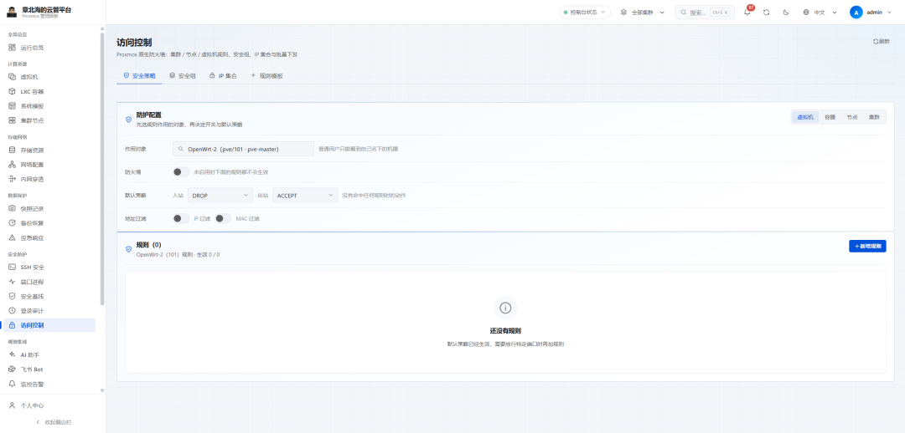

网络上还有 **IP 地址池**：一个池 = 子网 + 可分配范围 + 网桥，已占用地址由各虚拟机的静态配置扫描得出。它不依赖 DHCP 或 SDN；池的增删改仍要 `network.manage`。

建机时的网段选择**快速部署与自定义部署是同一套界面、同一套规则**（自定义部署里在「磁盘与网络 → 网卡」或克隆模式的「网络配置 → IP 列表」下）：每张网卡先选「IP 获取方式」——静态则选网段后自动预填该网段的空闲地址与网关，DHCP 也选网段（决定从哪条二层网络拿地址），选中网段会把网桥与 VLAN 一起对齐；下拉里只出现既属于本人、又对得上目标节点与当前网桥的池。下发时静态地址直接写进 `ipconfig0`（容器是 `net0`），DHCP 则把选中的池交给后端在创建时分配一个空闲地址写进配置 —— 也就是「由面板按池分配」，没有匹配的池才退回真正的 DHCP；克隆模式下这份选择随 `ip_configs` 下发，克隆体不会继承模板的同一个地址。

## 内网穿透（frp）

面板自带 frpc：填 frps 地址和 token 就能装、启停，后台作业会看着它，挂了自动拉起。规则把「某台虚机 / 容器的 `IP:端口`」映射到公网端口，端口默认限制在 40000–50000，管理员可以按 frps 实际放通的区间改（NAT / 云安全组只开了一段时尤其需要）；22 / 80 / 443 / 7000 / 7001 / 8006 等关键端口始终不可占用，跟区间无关。

<!-- 截图占位：screenshots/frp.png -->
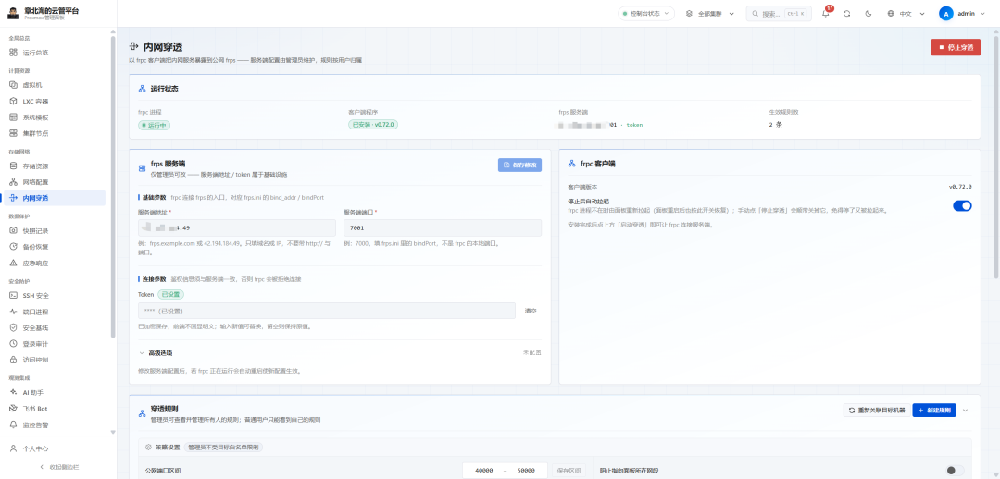

越权默认拒绝：普通用户只能映射自己名下的机器，目标还要过白名单（`FRP_ALLOW_LOCAL_CIDRS`，也能按人单独放行某些地址），回环、保留地址和面板自身地址始终拒绝，默认还禁止指向面板所在网段。增删改规则要二次确认；机器改派之后，旧规则会标成 `stale`，不会继续对别人生效。合并视图只下发本人的规则并抹掉 token，日志入口只有管理员能看。

## SSH 登录安全与 fail2ban

读的是面板所在主机的 SSH 日志，集群里其他宿主机的日志读不到，页面会写明数据来自哪台。日志来源按 `/var/log/secure` → `/var/log/auth.log` → `journalctl -u ssh -u sshd` 三级回退，只统计真正的认证失败，按 sshd 的 PID 去重，健康检查和端口扫描的噪声不算。失败来源按 IP 聚合，可一键封禁、标记可信、加忽略名单；fail2ban 的 jail、封禁数、解封与手动封禁都在页面上，自定义策略只写面板自己的 `jail.d/panel-<jail>.local`，不碰 `jail.local`。告警走监控已有的飞书和邮件通道：某 IP 失败超阈值、陌生 IP 登录成功都会通知，攻击停了发恢复通知。

在「受管主机」里填地址、用户、私钥或口令（用 `SECRET_KEY` 加密落库）后，远端也能做同样的事；首次连接要确认 SSH 指纹，之后指纹变了直接拒绝。权限分 `ssh.view`（默认人人可见）与 `ssh.manage`（封禁、改策略，默认仅管理员）。

<!-- 截图占位：screenshots/ssh-security.png -->
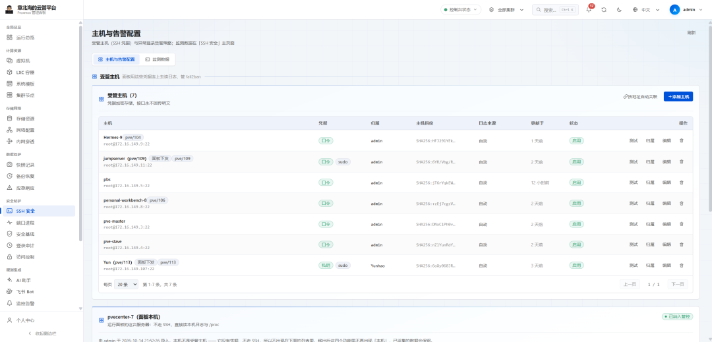

## 安全基线与端口巡检

两者共用一个架构。检测对象可以是本机（面板所在主机，直接读系统文件），也可以是受管主机（复用 SSH 通道，在远端跑一条只读命令把数据取回来本地解析）。本地和远端共用同一份判定逻辑，结论口径一致。权限是 `baseline.view` / `baseline.manage` 与 `ports.view` / `ports.manage`，后两个默认仅管理员。

<!-- 截图占位：screenshots/security-baseline.png -->
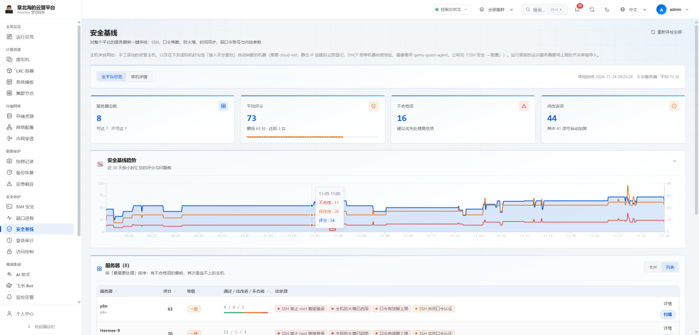

基线检查覆盖七类：SSH 配置、口令策略、防火墙、时间同步、账号安全（空口令、UID 0）、关键内核参数。评分按严重级别加权（高危 3、中危 2、低危 1）给 A～D 等级，检测不到的项不计入分母，权限不足不会被冤枉扣分。一键加固只写面板自己命名的文件，SSH 改完立刻 `sshd -t` 校验、sysctl 改完复读 `/proc`，校验不过自动回滚。关闭 SSH 口令认证这类可能把人锁在门外的项不纳入一键加固，得逐项确认。

端口巡检用 `ss -tulpn`（老系统退回 `netstat`）列出协议、监听地址、归属进程和暴露范围；监听在非回环地址就算「对外开放」，再结合同一次采集到的防火墙状态，没有活动防火墙时风险级别整体上调。可疑进程走反弹 shell 启发式：`/dev/tcp` 重定向、`nc -e`、`socat exec:`、脚本里的 socket 与 dup2、`curl|sh` 等，再叠加上下文特征（shell 持有对外连接、可执行文件在 `/tmp`、可执行文件已被删除、已知挖矿进程名）。策略里可以配「预期端口」和「进程白名单」正则压误报。

> 得说清楚：端口巡检是启发式，不是杀毒引擎。每条命中都会列出命中了哪条规则，面板也不会据此杀进程。「对外开放」只代表监听在非回环地址，能不能真被访问还看防火墙和上游网络，所以报告里把防火墙状态一并给出，由人判断。集群里的 PVE 节点想体检或巡检，把它当一台受管主机加进来就行，PVE API 没有「在节点本机执行 shell」的接口。

## 应急响应

- 可疑虚拟机一键隔离：先取证快照 → 再断网 → 再关机 → 顺手加 VM 保护。顺序是刻意的，反过来机器一关现场就没了。每步独立执行、单独回报，取证失败不会阻止断网，但会标红。断网是逐张网卡置 `link_down=1`，在原始配置串上增删那一段，`bridge`、`tag`、`macaddr` 原样保留。
- 备份防删：把备份卷登记为受保护，并尽量给 PVE 卷打上 `protected` 旗标，面板的删除接口会拒删受保护的备份。勒索软件就算拿到管理员会话也删不掉，必须先在界面上解除保护。另外定期把登记过的备份和 PVE 实际内容对一遍，不见了或元数据变了就告警。

勾完动作别急着点。右侧会先列出这四步具体要做什么，点「立即隔离」才真正执行，勾错哪一项当场就能看出来。

<!-- 截图占位：screenshots/isolation.png -->
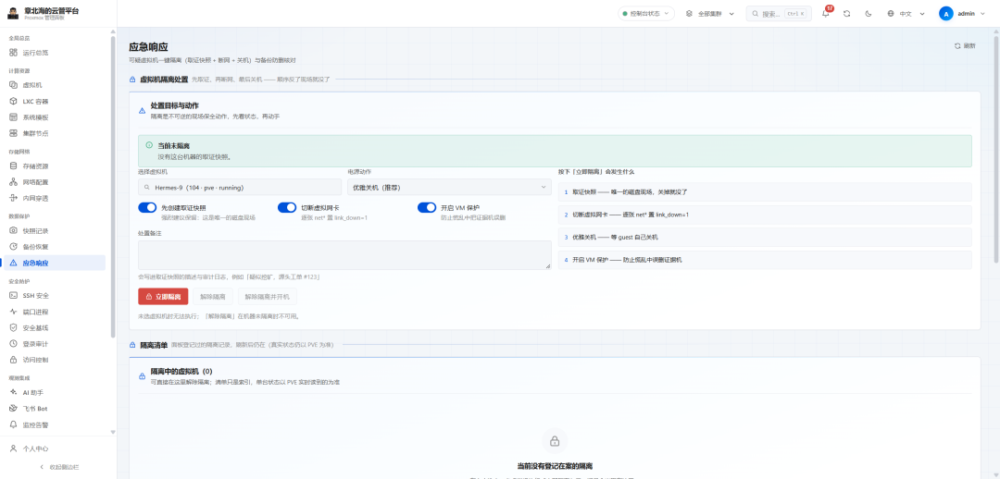

> 边界：真正的不可变（WORM）只能由存储侧保证（PBS retention、S3 Object Lock、只读挂载），只靠 PVE API 做不到。快照是崩溃一致性的磁盘副本，取不到内存镜像；`link_down` 只切断 PVE 虚拟网卡，PCI 直通 / SR-IOV 网卡不受控制。PVE 不返回存储内容的校验和，所以备份指纹是 `volid|size|ctime` 的哈希，能发现删除和替换，发现不了静默位翻转。

## AI 助手

把平台已有的巡检结果（安全基线 / 端口进程 / 登录审计 / 告警 / 变更记录 / 历史指标）交给大模型做归因，回答「先修哪一条」。它不是一次性摘要，而是能追问的会话：选一台可用目标 → 先读平台数据，必要时登录主机跑只读命令 → 边查边答 → 结论落成带 `source_ref` 的报告，每条都指回原始检查项，能自己核对。目标必须同时满足五项条件（运行中、已安全纳管、Guest Agent 正常、cloud-init 正常、是虚拟机），任一不满足都不进入候选；页面会说明原因与被排除的数量。

<!-- 截图占位：screenshots/ai-assistant.png -->
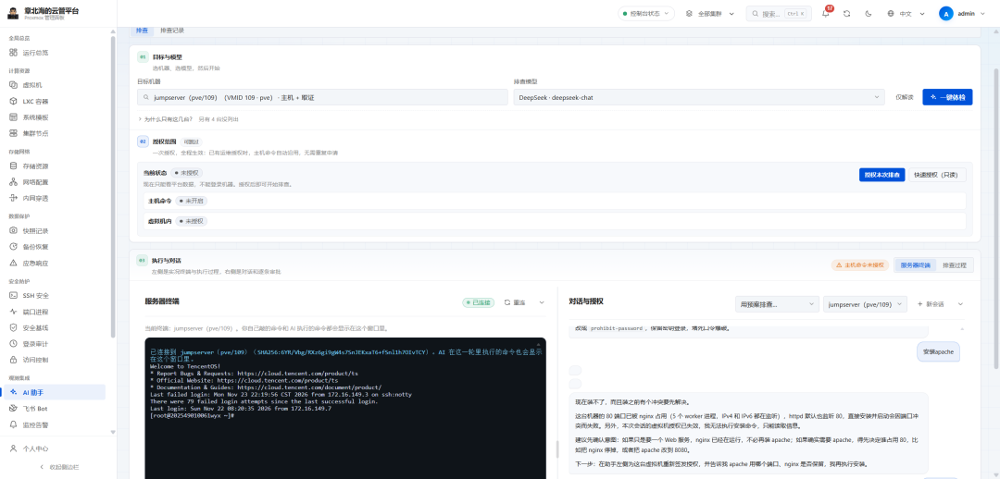

只读是默认档。工具是有限的参数化命令模板，没有「随便执行一条命令」的万能入口，参数有正则与路径白名单，不用 sudo。勾选「授权 AI 在目标主机执行命令」之后，模型才能自己组合只读命令（如 `ps aux | grep nginx`），每一段的首个可执行文件都必须在只读白名单内，且禁止 `;` `&&` `||`、重定向与命令替换，`/etc/shadow` 这类另有黑名单拦截。要改动系统的命令一律先展示、由你逐条批准才执行，`rm -rf /`、`mkfs`、`dd`、关机重启这类即便批准也直接拦下。

远程终端和它共用一个画面：浏览器内的交互式 SSH 终端（xterm.js 按需加载），你敲的命令、AI 跑的命令与输出按发生顺序排在一起，不用另开窗口对照「AI 到底在我机器上做了什么」。数据可见范围跟着权限走（普通用户只看自己名下虚拟机的告警 / 备份 / 巡检结果，SSH 登录分析要 `ssh.view`），每次运行的模型、步数、token 与逐条工具调用都落在「排查记录」里，可回看、可导出 CSV（一行 = 一次工具调用）。另有 Token 消耗入口，按 1 / 7 / 30 天看用量总额、输入输出构成与按模型明细。

需要 `ai.exec`（授权执行命令）与 `ai.terminal`（打开远程终端）两个权限，默认仅管理员。终端等于把该主机的登录凭据交给使用者，助手的执行能力也比其它页面强得多。

> 模型给的是归因建议，不是结论，每条都带 `source_ref` 指向原始检查项，请自行核对。命令白名单与黑名单由后端代码实时生成，「能力说明」里看到的就是执行时校验的同一份规则。授权只对当次会话有效，换主机或新建会话都会重置；写命令的审批有 120 秒超时，超时算拒绝。

## 监控与告警

VM 总数与运行分布、CPU / 内存 / 存储环形图、节点一览、最近任务、资源占用 Top 8；节点读数与虚拟机 / 容器的状态、CPU、内存走 `/ws/metrics`（3 秒一推，全标签页共用一条连接，断线自动重连并回落到「数据刷新间隔」轮询）。客户机状态 / 锁一变，列表与详情页的查询自动作废重取 —— 启动、关机、重装之后不必手动刷新浏览器；磁盘容量按节点根分区历史线性外推，给日均增长率和预计写满天数；节点与虚拟机各有 RRD 曲线。告警规则可配阈值与持续时间，通知可走邮件、飞书群机器人、通用 Webhook 和站内信（企业微信 / 钉钉 / Slack 用 Webhook 的请求体预设，填好模板即可），触发与恢复各发一条，每个渠道还能按告警来源单独停推。告警邮件发不出去时按 [告警邮件排查手册](告警邮件排查手册.md) 逐层定位，别在 SMTP 上盲试。

<!-- 截图占位：screenshots/monitoring.png -->
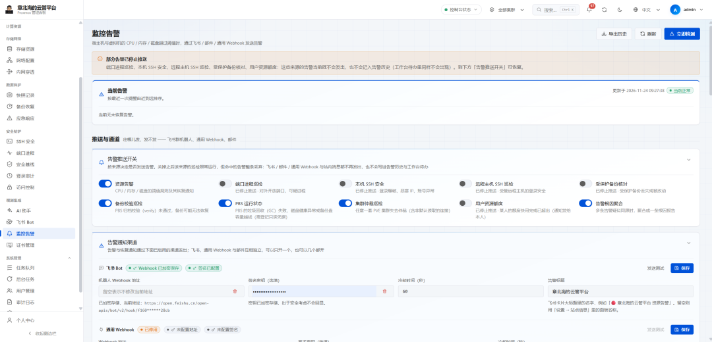

## 任务队列与站内通知

任务队列跨连接汇总（按集群作用域过滤），能看到 PVE 的原始执行日志、终止还在跑的任务、清掉历史记录；每一步都带归属校验，知道 UPID 也操作不了别人的任务。

站内通知在顶栏铃铛里：未读数单独轮询，点开是独立窗口而不是下拉。资源告警、首次从新 IP 登录、证书将到期、重装完成、面板有新版本这些事件都会投递；清空消息会进审计。它和邮件、飞书并行，配置里的「按来源停推」对它们一起生效。

## 飞书机器人

把面板接进飞书群：发「列表」「状态 <名称/ID>」「开机 <名称/ID>」「创建」「快照」「快照列表」「回滚」「备份」这类指令就能操作虚拟机；关机、重启、回滚会先发一张卡片，点了确认才执行。

回调入口靠签名与 Verification Token 校验，按 `event_id` 去重防重放，3 秒内处理不完就转后台。App ID / Secret / Encrypt Key 只有管理员能看能改，接口只回 `*_set`，读配置本身也进审计。

## 命令面板与全局搜索

`Ctrl / ⌘ + K` 打开命令面板：一半是页面跳转（按当前语言匹配，跟着权限和入口开关过滤），一半是资源搜索（虚拟机、节点、存储、用户四组并发，输入 200ms 防抖，走 `/api/search`）。↑↓ 选择、Enter 打开、Esc 关闭。

## 快照、备份与恢复

快照创建（可选含内存状态）、回滚、删除，另有一个把各机器快照汇总成一张表的跨虚拟机视图；立即备份（snapshot / suspend / stop 三种模式）、浏览备份卷、恢复到指定 VMID、删除；可视化创建 PVE 定时备份任务。备份卷可登记为受保护，面板的删除接口会拒删；后台作业定期把登记过的备份和 PVE 实际内容对一遍（`volid|size|ctime` 指纹），不见了或元数据变了就告警。

<!-- 截图占位：screenshots/backup.png -->

## PBS 备份服务器（可选）

PVE 里把 PBS 注册成存储之后，存储页就会显示 PBS 徽标、最近备份时间、归档数与校验状态，并给出控制台入口 —— 这一步零配置。

想进一步看到 PBS 自己的仓库容量、GC 计划、节点负载、最近任务和磁盘健康，去「节点 → 连接配置 → PBS 只读接入」登记一个只读 token。授权要**同时落在用户与 token 两套 auth-id 上**，共 4 行：`/datastore` 给 `DatastoreAudit`、`/system` 给 `Audit`，两个 auth-id 各一份。只授用户时 token 一律 403（token 默认权限分离，不继承用户 ACL）；只授 token 时网页端登录看不到仓库。这两个角色只含 `Datastore.Audit` + `Sys.Audit`，不含任何写权限，`Admin` 是多余的。面板对 PBS **只发 GET**：prune / GC / verify / sync 都交给 PBS 控制台，凭据层面也不给写权限。没登记凭据时整块安静隐藏，不会在备份页留一个空盒子。

两条互补的巡检会走告警通道：PBS 归档 verify 未通过（`备份校验巡检`），以及 GC 失败 / 磁盘健康异常（`PBS 运行状态`）。详见 [PBS监控.md](PBS监控.md)。

<!-- 截图占位：screenshots/pbs.png -->
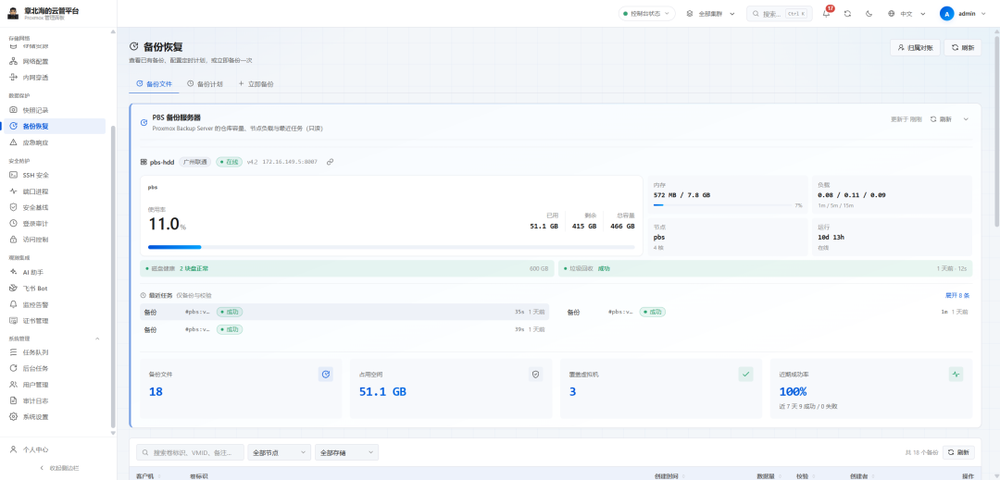

## VNC 控制台

浏览器内 noVNC 图形控制台，支持自动重连、全屏、发送 Ctrl+Alt+Del。后端做 WebSocket 双向透传，PVE 的 Web 界面不用暴露到公网。

## 登录审计与操作审计

主机登录审计：`last` / `lastb` 解析出账号、终端、来源 IP、时间与状态，另有开机记录和 auth.log 里的 sudo、su 提权。事件按每台主机一个游标增量汇入 `audit_log`，和面板自身的操作在同一张表里，后台每 5 分钟跑一次，重复汇入不会重复写。读不到 VM 内部的登录日志，但能按 VM 的 IP 匹配各主机的登录记录，回答「这台 VM 有没有被用来登录宿主机」。经 frp 暴露到公网的主机想记录真实来源 IP（而不是入口机地址），见 [frp 真实 IP 接入指南](frp-real-ip.md)。

<!-- 截图占位：screenshots/audit-log.png -->
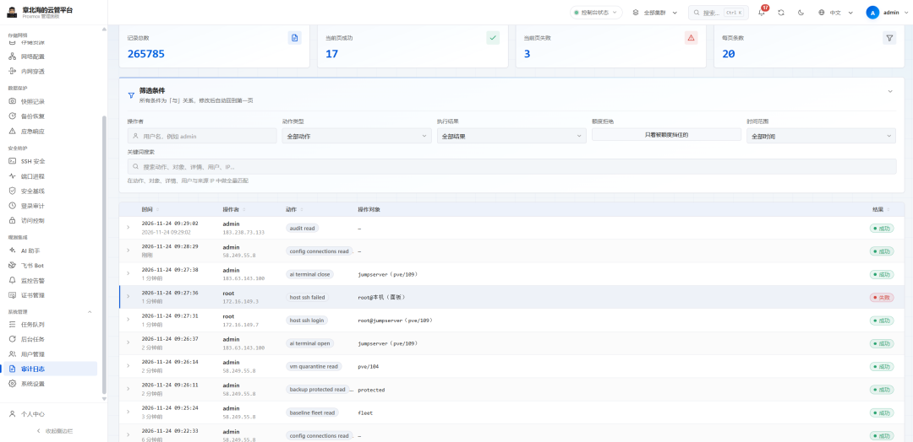

## 证书管理（ACME / 多云 / PVE 节点）

对接腾讯云、阿里云、华为云免费证书、自有 ACME 账号（Let's Encrypt / ZeroSSL / Google Trust Services / SSL.com / Actalis / Buypass，支持泛域名、多域名、IP 证书与 EAB 外部账户绑定）以及手动上传的托管证书。DNS-01 支持 DNSPod、阿里云、华为云、Cloudflare、GoDaddy、AWS Route 53、Namecheap、火山引擎。

到期前自动续期，按站点部署到本机目录、SSH 远程服务器、PVE 虚拟机（Guest Agent）、LXC 容器、PVE 节点自身的 8006 管理证书，或云负载均衡 / CDN（腾讯云 CLB、阿里云 SLB、腾讯云 CDN、阿里云 CDN）；部署后可执行重载命令，PVE 节点则由 PVE 自己落盘并重启 pveproxy。续期流水线支持站点级开关：可只签发不自动部署、可关闭到期提醒。

证书到期按 30/14/7/3 天分级预警，支持主动吊销（ACME revoke / 云厂商删除）；证书可按 PEM（zip）/ PFX 导出，证书清单带到期分布统计与库存快照。通知复用告警通道（站内信 / 邮件 / 通用 Webhook / 飞书），通用 Webhook 内置企业微信、钉钉（含加签）、Slack 预设。支持多站点绑定、到期监控与失败退避重试。

<!-- 截图占位：screenshots/certificates.png -->
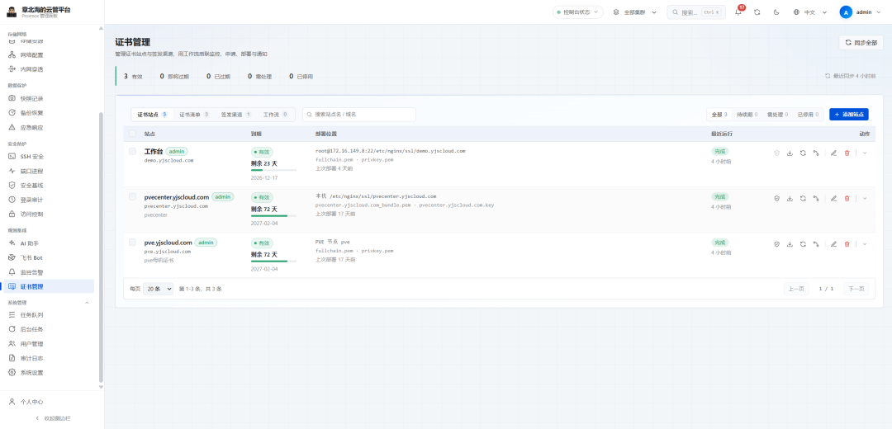

## 多用户、RBAC 权限与配额

| 内置角色 | 能做什么 |
|---|---|
| `admin` | 全部权限，含用户管理、连接配置、删虚拟机、集群级防火墙 |
| `operator` | 创建 / 开关机 / 控制台 / 快照 / 备份 / 克隆 / 改配置，管自己名下机器的防火墙，看 SSH 统计；不能管用户、不能删虚拟机、不能改集群级防火墙 |
| `viewer` | 只读 |
| `region_admin` | 区域管理员：只能看、只能管指派区域（连接的 `region` 标签）内的资源 |

内置角色之外还能建**自定义角色**：后端把权限按域整理成目录（`GET /api/permissions/catalog`），勾选即可；`admin` 不可改不可删，还有人在用的角色删不掉。

<!-- 截图占位：screenshots/users-rbac.png -->
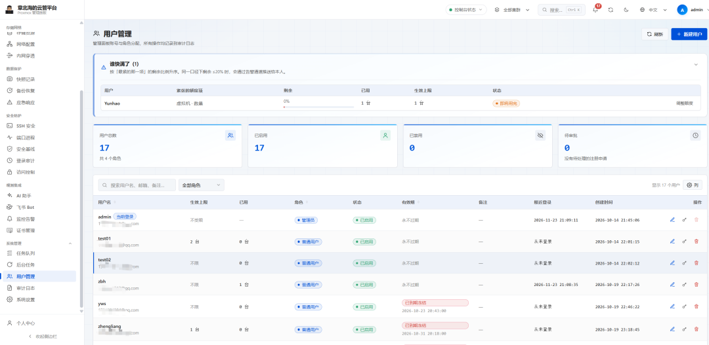

- 注册方式四选一（**默认关闭**，在「设置 → 注册方式」里切换，即时生效）：关闭 / 邀请制 / 注册码制 / 自助。邀请制与注册码制都在同一张凭证表里签发（明文只显示一次、只存哈希、原子消费，一码一人；可撤销、可设有效期与次数），切模式后另一种凭证立即失效。签发邀请链接 / 注册码时可预先指定角色、额度与「注册后是否需要管理员审批」：默认要审批、账号为 `pending`；关掉则注册成功即可直接登录，审批时沿用凭证预置的角色。审批结果发邮件（邮件是旁路，发不出去只记审计）。找回密码走一次性链接，不管账号存不存在都回同一句话，不给人试账号的机会。
- 所有写操作（含失败的）进审计日志，记用户、动作、目标、结果、详情、来源 IP，可按条件筛；结果是 `success` / `failed` / `partial` / `denied` / `accepted` 之一。普通账号即便有 `audit.view` 也只能看自己的记录，读审计本身同样留痕。
- 防呆：不能删、禁用或降级最后一个管理员，不能删当前登录账号。
- 资源额度分两层：先看用户自己有没有配，没配就继承角色默认值，两层都没配才不限制。维度是虚拟机与容器各自的台数、核数、内存、磁盘，另有单台核数 / 内存 / 磁盘封顶与快照数（总数 + 单机上限）。「继承」和「自定义但留空」不是一回事，后者表示显式不限制，会盖掉角色默认值。额度不只拦创建：改配置、加盘扩容、建快照同样校验，只守进门那一步等于没守。普通用户的读数只统计自己名下的机器，全平台已用 / 上限只在管理员和设置页展示 —— 免得把「集群还剩几台」当成「我还能建几台」，也不暴露集群规模。
- 设置里的连接配置可以在线改，存 MySQL，保存即生效不用重启，Token Secret 前端拿不到明文。「环境自检」会问 Proxmox 要当前凭据的有效权限，逐项列出 API 可达性、节点可见性、存储、虚拟机、控制台凭据是否正常，并把异常转成能直接执行的修复命令。

## 账号安全：两步验证、会话与 API 令牌

个人中心分「基本信息 / 修改密码 / 两步验证 / API 令牌 / 登录设备 / 我的权限」。两步验证绑定后给 8 张一次性恢复码，只显示一次；`TOTP_REQUIRED_ROLES` 能把某个角色设成必须先绑定才能用面板。勾了「信任设备」的浏览器 7 天内免输动态码，`TOTP_TRUST_ENABLED=false` 时每次都要过第二因子。

登录设备列出当前有效会话，能逐个踢下线，也能一键退出所有设备；管理员可以踢某个账号的全部会话，改密码同样会让其它设备上的令牌作废。同一账号最多保留 `SESSION_MAX_PER_USER` 台设备，超出的新登录挤掉最旧的一台。

个人 API 令牌用于自动化：有效期上限 365 天，不接受「永不过期」，明文只在创建时出现一次（库里存 SHA-256），签发和吊销都要求浏览器会话 + 二次确认。过期令牌由后台作业清理。

## 面板自身维护（更新 / 作业 / 品牌 / 入口开关）

- **更新**：设置页检查新版本，可以跳过某个版本，也可以改发布仓库。「立即更新」按安装形态换代码：源码包安装下载 tar.gz 后 `rsync` 覆盖（排除 `.git`、`backend/.env`、`data`、`dist` 等），git 安装则 `git fetch` + `checkout`，两者最后都跑 `deploy.sh` 重启，接口立刻返回，进度看日志文件。国内拉不到 GitHub 时设 `PC_UPDATE_MIRROR` 镜像前缀 —— 源码包与 git 两种形态都会回退到它。
- **后台作业**：面板自己的定时任务都列在这一页（各种巡检、告警、证书续期、归属对账、数据清理、frp 看护、版本检查等），间隔 10 秒到 30 天可调，能单独启停、立即执行并看这次的结果，也能恢复默认值。
- **站点品牌**：站点名、副标题、备案号，自定义 Logo 与登录页背景图（上传即生效，可移除回落到内置图标）。`/api/config/site` 保持匿名，登录页读它渲染。
- **入口开关**：可以逐个关闭侧边栏入口。关掉之后侧边栏、顶栏菜单、`Ctrl + K` 和直达 URL 一起失效，但**接口不因此拒绝**（入口不等于授权）；只有「系统设置」永远保留，否则就没地方恢复了。
